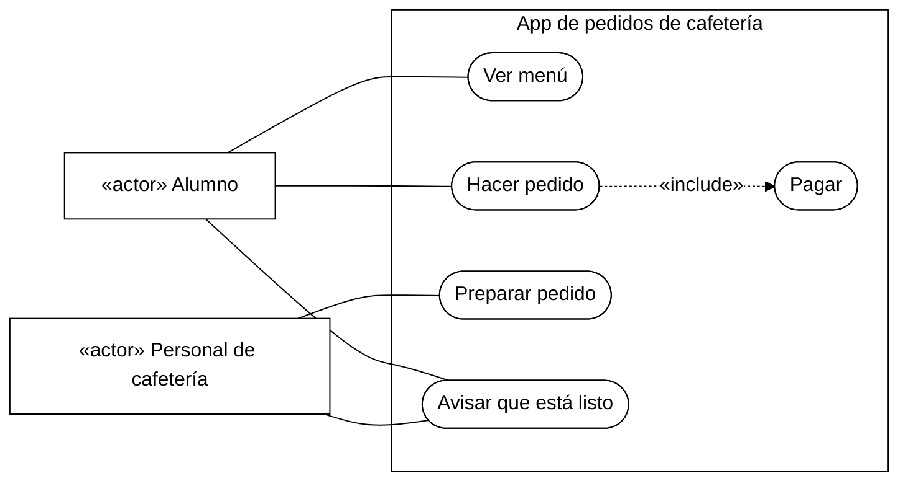
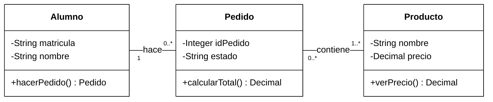
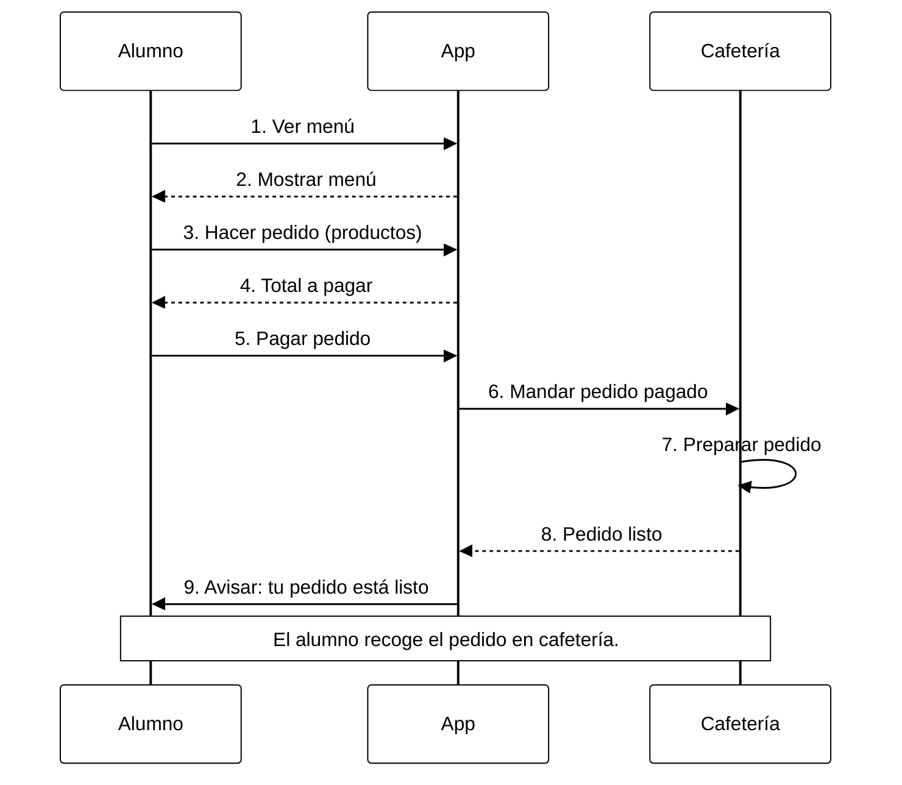

# Actividad: Modela tu primera app

## App de pedidos para la cafetería universitaria

El alumno ve el menú en su celular, hace su pedido y lo paga. El personal de la cafetería lo prepara y marca en la app que ya está listo. La app le avisa al alumno para que pase a recogerlo.

**Así funciona la app:** primero se paga y después la cafetería recibe el pedido para prepararlo. Cada pedido lleva al menos un producto. Aquí mostramos qué pasa cuando todo sale bien. El alumno recoge su pedido en la cafetería.

## 1. Diagrama de casos de uso

- **Alumno:** ve el menú, hace su pedido, lo paga y recibe el aviso cuando está listo.
- **Personal de cafetería:** prepara el pedido y marca en la app que está listo para que le llegue el aviso al alumno.
- **Límite del sistema:** el rectángulo marca lo que forma parte de la app de pedidos.
- **Cinco casos de uso:** Ver menú, Hacer pedido, Pagar, Preparar pedido y Avisar que está listo.
- **Relación:** `Hacer pedido ..> Pagar : «include»`. La flecha va de Hacer pedido hacia Pagar. Esto significa que pagar es una parte obligatoria de hacer el pedido.

En “Preparar pedido”, el personal revisa el pedido y cambia su estado en la app mientras prepara la comida. “Avisar que está listo” le dice al alumno que ya puede pasar a recogerlo.

### Versión editable en Mermaid

Mermaid no tiene una opción propia para dibujar casos de uso. Por eso, el código de abajo usa un diagrama de flujo parecido. En el PNG sí aparecen los monitos y los óvalos de UML.

## 2. Diagrama de clases

Cada cuadro es una clase y tiene **dos atributos privados (`-`) y un método público (`+`)**, como pide la actividad. Los atributos son los datos que guarda y el método es algo que puede hacer. Las líneas conectan las clases: un alumno hace pedidos y cada pedido lleva productos.

**Qué significan los números de las relaciones (multiplicidad):**

- Un alumno puede hacer **cero o muchos pedidos (`0..*`)**. Cada pedido pertenece a **un alumno (`1`)**.
- Un pedido lleva **uno o más productos (`1..*`)**. Un producto puede aparecer en **cero o muchos pedidos (`0..*`)**.

Para esta actividad usamos solo las tres clases que se piden. Dejamos fuera detalles como cuántas unidades se compran de cada producto y cómo se procesa el pago.

## 3. Diagrama de secuencia

Este diagrama muestra, paso a paso, cómo se hace un pedido. Participan **Alumno, App y Cafetería**, cada uno con su línea de vida. Hay nueve mensajes; tres son respuestas de retorno y se dibujan con rayitas.

## Archivos para entregar

- `actividad.md`: explicación y los tres diagramas en Mermaid, junto con sus imágenes.
- `01_casos_de_uso.png`: quién usa la app y qué puede hacer.
- `02_clases.png`: los datos, métodos y relaciones de las tres clases.
- `03_secuencia.png`: los pasos para hacer un pedido.

Guarda el archivo `.md` y las imágenes en la misma carpeta para que se vean en GitHub. También puedes subir los PNG a Classroom.

**Mensaje de commit sugerido:** `Agrega diagramas UML de la app de pedidos`.

## Video de referencia

[UML Tutorial: Diagrama de Clases desde cero — Lucid Software Español](https://www.youtube.com/watch?v=Z0yLerU0g-Q).

Se pudieron revisar el título y la descripción del video, pero no reproducirlo ni leer una transcripción. Los diagramas siguen lo que pide la imagen de la actividad.
